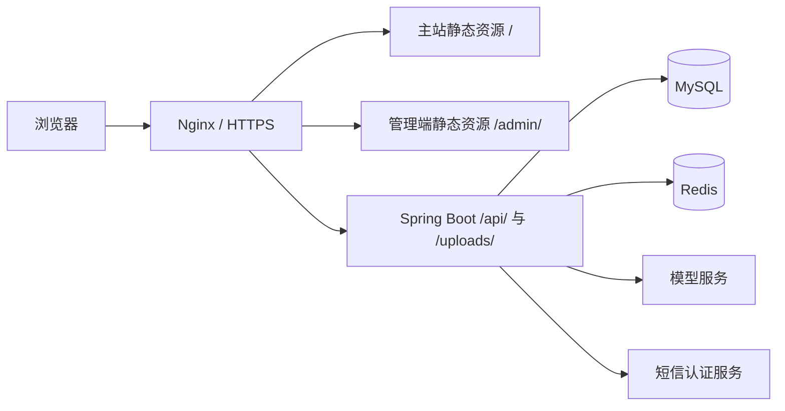

# Unicorn Studio

**独角兽工作室网站：主站、管理后台与 AI 助手。**

围绕工作室介绍、作品展示、学习资料和社群招募构建的全栈项目。通过管理后台维护页面内容、媒体资源、账号权限和 AI 配置，主站从后端读取已发布内容。

[快速开始](#快速开始) · [配置说明](#配置说明) · [构建与验证](#构建与验证) · [部署](#部署) · [相关文档](#相关文档)

## 功能

| 模块 | 主要能力 |
| --- | --- |
| 主站 | 首页、关于我们、作品列表与详情、学习资料列表与详情、加入我们；支持主题切换、背景图片与视频、响应式布局和页面动态效果。 |
| 内容管理 | 作品与新闻管理、学习资料与分类管理、发布状态、排序、轮播与背景资源、招收方向、培养能力、页脚及站点设置。 |
| 页面配置 | 首页、关于我们、加入我们和页脚内容维护；管理端提供预览入口，与主站共用展示契约。 |
| 用户与互动 | 手机验证码注册、用户登录、评论提交与审核、留言处理、用户状态管理。 |
| AI 助手 | SSE 流式对话、会话历史、历史消息分页与清空、Markdown 展示、头像配置、模型配置和连通性测试。 |
| AI 工具 | 内置站点数据查询工具、API 工具配置与测试、工具启停、调用预算、超时和熔断。 |
| 后台权限 | 管理员账号、角色与权限码、菜单及操作权限、前后台独立的 JWT 身份体系。 |
| 运维管理 | 访问统计、操作日志、SQL 监控、数据库与上传文件备份、数据保留清理、健康检查。 |
| 缓存 | Redis 读缓存、预热、TTL 抖动、故障降级；支持应用写入及手动 SQL 修改后的缓存失效。 |

新闻已提供后台管理和公开 API；当前主站路由以作品、学习资料和工作室介绍为主。

## 技术栈

| 层级 | 技术 |
| --- | --- |
| 主站 | Vue 3、JavaScript、Vite 6、Vue Router、Pinia、Tailwind CSS、tsParticles |
| 管理后台 | Vue 3、TypeScript、Vite 5、Element Plus、Pinia、Axios、ECharts、wangEditor |
| 后端 | Java 21、Spring Boot 3.3、Spring Security、MyBatis-Plus、Druid |
| AI | Spring AI、兼容 OpenAI 协议的模型服务、SSE、工具调用 |
| 数据与缓存 | MySQL 8.0、Redis、Lua |
| 构建与部署 | Maven、npm、Docker Compose、Nginx；主站另提供 Node.js 服务 |

具体依赖版本以各模块的 `package.json`、`package-lock.json` 和 `backend/pom.xml` 为准。

## 项目结构

```text
Unicorn-Studio/
├── frontend/                      # 主站
│   ├── src/                       # 页面、组件、状态和交互效果
│   ├── public/                    # robots.txt、sitemap.xml 等静态文件
│   ├── server/                    # Node.js 静态服务与后端代理
│   └── scripts/                   # 开发、构建、检查与冒烟测试
├── admin/                         # 管理后台
│   ├── src/                       # 管理页面、权限、接口和预览
│   └── scripts/                   # 类型检查、构建与产物验证
├── backend/                       # Spring Boot 后端
│   ├── src/main/java/             # 公开 API、后台管理、AIWorker、缓存等
│   ├── src/main/resources/        # 应用配置和缓存依赖定义
│   ├── src/test/                  # 回归测试与可选集成测试
│   └── sql/                       # 初始化、升级 SQL 与生成工具
├── shared/                        # 共用品牌资源和页面展示契约
├── scripts/                       # 品牌同步、前后台协同验收
└── deploy/afq.asia/                # Docker、Nginx、HTTPS 与部署脚本
```

主站和管理端分别安装依赖、构建和启动，仓库根目录没有统一的 npm 工作区。

## 架构

生产环境的 Docker 部署采用同域访问：主站位于 `/`，管理端位于 `/admin/`，业务接口位于 `/api/`。



本地执行主站的 `npm run dev` 时，会同时启动 Vite 和 Node.js 代理服务；主站请求经 Node.js 转发至 Java 后端。管理端开发服务器直接代理至 Java 后端。上述 Docker 生产方案由 Nginx 提供静态资源和代理，不需要单独运行 Node.js。

## 快速开始

### 1. 环境准备

| 依赖 | 要求 |
| --- | --- |
| JDK | 21 |
| Maven | 3.9.x |
| Node.js | 22 或 24，配套 npm |
| MySQL | 8.0.19 或以上的 8.0 版本，使用 `utf8mb4` |
| Redis | 需支持 Lua 脚本；默认连接本机 `6379` |
| Git | 用于克隆仓库 |

数据库脚本按 MySQL 8.0 编写，不适用于 MySQL 5.7 或 MariaDB。使用备份功能时，后端运行环境还需安装可用的 `mysqldump`。

```bash
git clone https://github.com/qiaojoin586-droid/Unicorn-Studio.git
cd Unicorn-Studio

npm --prefix frontend ci
npm --prefix admin ci
```

### 2. 准备数据库

按数据库状态选择一份脚本：

| 数据库状态 | 脚本 |
| --- | --- |
| 全新数据库或已有空库 | `backend/sql/server-migration/01-init.sql` |
| 已有业务表和数据 | 先备份，再使用 `backend/sql/server-migration/02-upgrade.sql` |

例如，全新数据库可在 Bash / Git Bash 中执行：

```bash
mysql --no-defaults --default-character-set=utf8mb4 -h127.0.0.1 -u root -p < backend/sql/server-migration/01-init.sql
```

两份脚本是二选一的部署入口。已有业务库不要执行初始化；执行结束需确认没有错误，且最终输出 `DEPLOYMENT_SQL_OK`。脚本不会由后端启动过程自动执行。

初始化只包含结构及系统默认配置、角色、权限和默认分类，不导入示例作品、真实用户或模型凭据。详细规则见[数据库部署说明](backend/sql/server-migration/README.md)。

### 3. 配置本地后端

在 `backend/` 下创建 `application-local.yml`。该文件已被 `.gitignore` 排除，适合保存自己的本地配置。

将以下示例中的密码及密钥替换为自己的值。三个密钥分别生成并保存，不要在每次启动时重新生成；`app.crypto.secret` 用于解密已保存的 AI 凭据，需要持续保留。

```yaml
spring:
  datasource:
    url: jdbc:mysql://127.0.0.1:3306/unicorn_studio?useUnicode=true&characterEncoding=utf8&useSSL=false&serverTimezone=Asia/Shanghai&allowPublicKeyRetrieval=true
    username: root
    password: "填写本机 MySQL 密码"
  data:
    redis:
      host: 127.0.0.1
      port: 6379
      # 本机 Redis 没有设置密码时保持空值。
      password: ""

app:
  admin:
    jwt-secret: "填写独立生成的至少32字符随机值"
    init-password: "填写初始管理员密码"
  public:
    jwt-secret: "填写另一个独立生成的至少32字符随机值"
    registration-sms:
      provider: console
  crypto:
    secret: "填写第三个独立生成并保存的至少32字符随机值"
```

可分别运行下面的命令，为三个密钥各生成一份随机值：

```bash
node -e "console.log(require('node:crypto').randomBytes(32).toString('hex'))"
```

此配置把注册短信切换为本地控制台通道，获取验证码后到后端控制台查看，不发送真实短信。

### 4. 启动三个应用

分别打开三个终端，进入对应目录运行。

**后端：**

```bash
cd backend
mvn spring-boot:run "-Dspring-boot.run.profiles=local"
```

命令需要在 `backend/` 工作目录执行，以便 Spring Boot 读取该目录下的 `application-local.yml`。

**主站：**

```bash
cd frontend
npm run dev
```

**管理端：**

```bash
cd admin
npm run dev
```

默认访问入口：

| 服务 | 地址 | 说明 |
| --- | --- | --- |
| 主站 | [http://localhost:5173/](http://localhost:5173/) | Vite 开发页面；以终端实际输出的端口为准 |
| 管理端 | [http://localhost:5174/admin/](http://localhost:5174/admin/) | 管理端的 base 为 `/admin/` |
| Java 后端 | [http://127.0.0.1:8080/api/health](http://127.0.0.1:8080/api/health) | 检查数据库及 Redis 连通性 |
| 主站 Node 服务 | [http://127.0.0.1:3000/api/health](http://127.0.0.1:3000/api/health) | 仅检查 Node 进程自身；端口占用时开发脚本会自动寻找可用端口 |

### 5. 首次使用

新库首次启动后，后端会根据内置 `SUPER_ADMIN` 角色初始化管理员。使用用户名 `admin` 和 `app.admin.init-password` 中设置的密码登录；首次登录需要修改密码。已有数据库会保留现有账号，不通过此配置重置密码。

随后在后台维护站点名称、联系信息、页面内容、作品、学习资料、背景及二维码等真实内容。作品、新闻和资料需要按各自状态规则发布或上架后，才会进入对应公开接口。

## 配置说明

### 后端配置与凭据

基础配置位于 `backend/src/main/resources/application.yml`；本地使用外部 `application-local.yml` 覆盖，生产使用外部配置文件和进程环境变量。

| 配置 | 用途 |
| --- | --- |
| `spring.datasource.*` | MySQL 连接、用户名和密码 |
| `spring.data.redis.*` | Redis 地址、端口、密码及连接参数 |
| `app.admin.jwt-secret` | 管理端 JWT 签名密钥 |
| `app.public.jwt-secret` | 前台用户 JWT 签名密钥，与管理端独立 |
| `app.crypto.secret` | AI API Key 等敏感配置的加密密钥 |
| `app.admin.init-password` | 新建初始管理员时使用的密码 |
| `app.site.base-url` | 站点对外地址，供 AI 工具生成完整链接等场景使用 |
| `app.upload.dir` | 上传文件保存目录，默认相对路径为 `data/uploads` |
| `app.backup.dir` | 备份保存目录，默认相对路径为 `data/backups` |
| `app.backup.mysqldump-path` | 后端可执行的 MySQL 备份客户端路径 |

相对路径以 Java 进程的工作目录为基准。按上述本地启动方式，上传和备份位于 `backend/data/`。

后端支持读取外部 `.env`，格式参考 `backend/.env.example`。默认先查工作目录的 `.env`，再查兼容的资源目录路径，只使用第一个存在的文件；也可通过 `APP_ENV_FILE` 明确指定。该机制用于提供配置中引用的变量，例如短信凭据；完整的 Spring 配置仍建议放在上述外部 YAML 或进程环境变量中。真实配置、数据导出及密钥不要提交到仓库。

### AI 助手

1. 登录管理端，在 AI 配置中设置模型服务地址、API Key、模型名称和功能开关。
2. 使用连通性测试确认服务可用，再到主站登录用户后进行对话。
3. 按需要维护系统提示词、输出参数、头像和工具启停状态。

模型配置存储于数据库，API Key 经服务端加密保存。主站及 Node.js 代理不需要持有模型密钥。

自建或新增模型服务域名时，需要配置 `app.ai.allowed-api-hosts`（环境变量 `AI_ALLOWED_API_HOSTS`）；工具访问规则与模型服务地址规则分别由后端校验。AI 会话上下文、历史清理和日/月配额可在 `app.ai` 下调整，配额默认关闭。

### 注册短信

- `console`：本地开发使用，验证码输出到后端控制台。
- `aliyun`：真实短信通道，接入阿里云号码认证的 `SendSmsVerifyCode`。

切换真实通道时，将 `app.public.registration-sms.provider` 配置为 `aliyun`，并提供 AccessKey、可用签名和模板。短信有冷却、滚动小时额度、验证码有效期及错误尝试限制。

接口、配置变量和授权说明见[注册短信接入文档](backend/SMS_SETUP.md)。

### 主站和管理端代理

| 变量 | 作用 |
| --- | --- |
| `API_PROXY_TARGET` | 主站 Node 服务代理的 Java 后端地址，默认 `http://127.0.0.1:8080` |
| `VITE_API_PROXY_TARGET` | Vite 开发代理目标；管理端默认指向 Java，主站联合开发脚本默认指向其 Node 代理 |
| `VITE_PUBLIC_SITE_URL` | 管理端打开或预览主站时使用的地址；分域部署时配置 |
| `VITE_ADMIN_SITE_URL` | 主站预览嵌入白名单等使用的管理端地址；分域部署时配置 |

`frontend/.env.example` 和 `admin/.env.example` 提供示例。主站 Vite 配置设置了 `envDir: false`，因此主站构建使用的 `VITE_*` 变量需要通过进程环境注入；主站 `.env` 由 Node 服务和联合开发脚本读取。

## 缓存一致性

MySQL 是业务数据的来源，Redis 保存读取结果。应用写入在事务提交后立即使相关缓存域失效；手动 SQL 的行级增删改通过数据库触发器推进版本，由后端默认每秒检测一次并发布到当前环境的 Redis。

缓存键按环境前缀及版本代号隔离，旧查询回填时沿用它开始时捕获的代号，避免失效后的旧数据重新进入有效缓存。页面 VO 与其依赖的设置组共享缓存域。

- 支持手动 `INSERT`、`UPDATE`、`DELETE`，不依赖手动维护 `updated_at`。
- 这是秒级最终一致，不承诺 SQL 提交瞬间所有请求都读取新值。
- 迁移未完成、监听异常或监听过期时，数据库派生的 Redis 读缓存会停用并回源 MySQL，恢复后重新换代。
- 验证码、令牌、限流计数和未落库的浏览量增量属于 Redis 状态数据，不随读缓存换代清除。

`TRUNCATE`、替换表和恢复备份等运维操作需按[数据库部署说明](backend/sql/server-migration/README.md#手动-sql-修改后的缓存自动生效)处理。新增缓存或数据表依赖时，同步维护 `backend/src/main/resources/cache-dependencies.json` 并重新生成部署 SQL。

## 构建与验证

以下命令从仓库根目录执行。

```bash
# 后端：测试并打包
mvn -f backend/pom.xml "-Dmaven.test.redirectTestOutputToFile=true" package

# 主站：静态检查、Vite 构建和部署文件整理
npm --prefix frontend run build

# 管理端：类型检查、Vite 构建及产物检查
npm --prefix admin run build
```

| 模块 | 主要产物 |
| --- | --- |
| 后端 | `backend/target/unicorn-studio-<版本>.jar` |
| 主站 | `frontend/frontend/`，静态入口为其中的 `index.html` |
| 管理端 | `admin/dist/`，部署路径为 `/admin/` |

主站的构建脚本还会复制 Node 服务、脚本等文件到输出目录；Nginx 部署时应通过现有准备脚本仅选取静态资源，避免把整个目录直接作为公开站点根目录。

其他检查命令：

```bash
# 后端常规回归；外部服务集成测试按各自开关启用
mvn -f backend/pom.xml "-Dmaven.test.redirectTestOutputToFile=true" test

# 主站定向检查
npm --prefix frontend run verify:sse
npm --prefix frontend run verify:footer-links

# 修改 shared/ 品牌定义后生成两端资源，再检查是否同步
node scripts/sync-design.mjs
node scripts/sync-design.mjs --check
```

`npm --prefix frontend test` 会先构建，再运行 Node 服务冒烟测试；需要可连接的 Java 后端，以及已经发布的作品、学习资料和招收方向数据。新建的空业务库不满足这些数据断言。

`scripts/verify-site-coordination.mjs` 用于编译产物上的前后台协同验收，使用确定的模拟接口数据；运行前需完成两端构建，并准备 Playwright 及对应浏览器。短信和数据库缓存的真实集成测试启用方式见各自文档。

## 部署

仓库提供 `deploy/afq.asia/` 作为 Docker + Nginx + HTTPS 部署示例。示例域名、证书文件、数据库账号和网络名称需要按自己的环境调整。

该 Compose 只管理应用后端和 Nginx，依赖已经存在的 MySQL、Redis 以及外部 Docker 网络 `app-network`，不是包含所有依赖的一键初始化方案。

Windows 下安装好两个前端的依赖后，可在项目根目录执行：

```powershell
powershell -NoProfile -ExecutionPolicy Bypass -File deploy/afq.asia/build.ps1
```

脚本依次构建后端、主站和管理端，检查成功后整理 `html/`、数据库 SQL 等部署文件。随后按部署文档完成外部配置、数据库初始化或升级、证书及持久化目录配置，再启动容器。

部署时需要保留上传文件、数据库数据和原有加密密钥。数据库结构升级应先于新后端启用；当前缓存监听功能需要版本表和触发器。完整步骤见 [Docker 与 HTTPS 部署文档](deploy/afq.asia/README.md)和[数据库部署说明](backend/sql/server-migration/README.md)。

## 常见问题

**主站出现 502 或接口不可用**

先直接访问 Java 后端的 `/api/health`，确认后端及数据库、Redis 状态，再检查 Node / Vite 的代理地址。主站 Node 的 `/api/health` 只代表 Node 自身存活。

**后台保存或手动改库后，页面仍是旧内容**

确认已经执行当前版本的数据库升级，并在后端日志中看到“数据库缓存变更监听已就绪”。手动 SQL 的更新存在轮询延迟；`TRUNCATE`、恢复备份等操作另按数据库文档处理。

**管理端白屏或刷新子路由后 404**

检查管理端是否部署在 `/admin/`，以及 Nginx 的 SPA 路由回退和静态资源路径是否与构建结果一致。

**AI 功能不可用**

检查功能开关、模型名称、API Key、模型地址白名单和后台连通性测试结果。迁移后无法解密旧凭据时，核对是否保留了原来的 `app.crypto.secret`。

**备份提示找不到 `mysqldump`**

客户端必须存在于 Java 后端实际运行的环境中。使用容器时，在宿主机或 MySQL 容器内安装客户端不能替代后端容器内的客户端。

## 相关文档

- [数据库初始化、升级与缓存变更监听](backend/sql/server-migration/README.md)
- [Docker、Nginx 与 HTTPS 部署](deploy/afq.asia/README.md)
- [注册短信认证接入](backend/SMS_SETUP.md)
- [主站星空开场效果](frontend/STAR_INTRO_EFFECT.md)
- [后端配置](backend/src/main/resources/application.yml)
- [共用页面展示契约](shared/presentation-contract.js)

## 参与开发

提交变更时说明涉及的模块、行为变化和验证方式。页面配置或预览协议调整需同步检查 `shared/`、主站和管理端；数据库调整需维护生成工具及两份部署入口。提交前确认没有包含本地配置、密钥、业务数据导出或构建产物。
